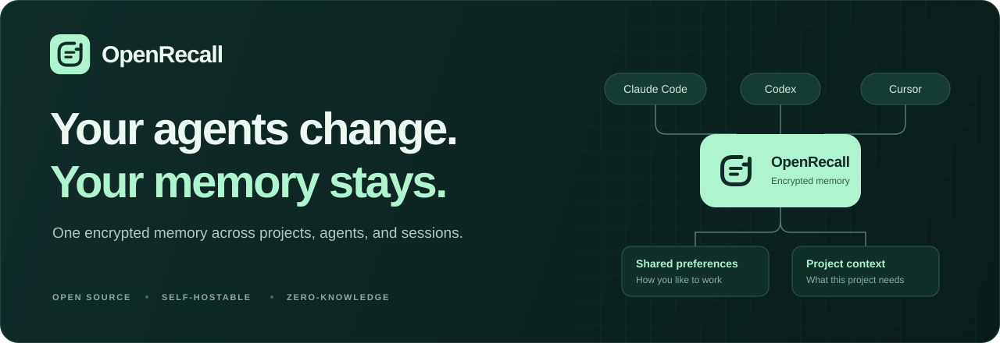

<p align="center">
  <picture>
    <source media="(max-width: 640px)" srcset="docs/assets/brand/openrecall-banner-mobile.svg" />
    
  </picture>
</p>

<h1 align="center">One memory. Every agent.</h1>

<p align="center">
  Persistent context for your whole agent stack.<br />
  Open source. Local by default. Encrypted before storage.
</p>

<p align="center">
  <a href="https://github.com/Twigpine/openrecall/actions/workflows/ci.yml"></a>
  <a href="https://www.npmjs.com/package/@twigpine/openrecall"></a>
  <a href="https://www.npmjs.com/package/@twigpine/openrecall"></a>
  <a href="SECURITY.md"></a>
  <a href="LICENSE"></a>
  <a href="https://github.com/Twigpine/openrecall/tags"></a>
  <a href="https://github.com/Twigpine/openrecall/discussions"></a>
  <a href="https://discord.gg/k68zFR6AcB"></a>
  <a href="https://x.com/twigpine"></a>
</p>

<p align="center">
  <a href="#quick-start">Quick start</a> ·
  <a href="#memory-across-projects">Project memory</a> ·
  <a href="#use-from-any-agent">Agent setup</a> ·
  <a href="#self-host-a-server">Self-host</a> ·
  <a href="#security-model">Security</a> ·
  <a href="#community">Community</a>
</p>

Switch agents. Come back to a project next week. Keep the useful context.

**OpenRecall is the memory layer for your agents:** shared preferences, project
decisions, and durable notes that Claude Code, Codex, Cursor, Zero, OpenClaude,
and your own agents can reuse. Memory is encrypted on your machine; the local
store or sync server holds ciphertext. Start locally, then self-host when you
want the same memory on more than one machine.

Built by [Twigpine](https://twigpine.com), alongside
[Zero](https://github.com/Twigpine/zero) and
[OpenClaude](https://github.com/Twigpine/openclaude).

## Why OpenRecall

| What you need | What OpenRecall gives you |
|---|---|
| Context that survives a new session | Durable notes your connected agents can recall and update |
| Preferences shared across tools | One MCP memory interface for every connected agent |
| Projects that stay organized | Discoverable project scopes, with shared preferences recalled alongside project facts |
| Control over your data | Encryption on your machine, with local storage or a server you run |
| A small first step | Install, initialize, connect your agents; local mode needs no server |
| Memory worth keeping | A shared agent guide for recall, deduplication, and pruning, plus a scanner that blocks likely secrets |

## Quick start

```bash
npm i -g @twigpine/openrecall     # Node 24.22.1+
openrecall init                   # one passphrase, kept owner-only in ~/.openrecall
openrecall setup all --write      # connect every agent found on this machine
openrecall status                 # check the config and the store
```

Restart your agents and they share one memory. No server is involved: this is
local mode. `setup` without `--write` is a dry run that prints every change
first; where an agent has its own `mcp add`, that is what it uses, and any JSON
file it edits is backed up. Per-agent notes, including Zero's sandbox and the
Claude Code / OpenClaude plugin, are in [docs/agents.md](./docs/agents.md).

To point an agent at a hosted service instead, print the block to paste:

```bash
# prints the MCP config block, plus a fresh passphrase shown once
openrecall card <owner> https://memory.twigpine.com
```

The passphrase is generated locally and never leaves the machine: it is printed
for you to store, and the block carries a placeholder rather than the value. The
service key is never printed either, even if `OPENRECALL_API_KEY` is set; paste
it into the block yourself. The URL must be `https` unless it points at a
loopback host.

That block is a public interface, not example output. The consumer integrations
point back at it rather than restating it, and a test asserts that every
environment variable it emits is one the server still reads, so a rename here
fails in this repository instead of at spawn time in another one.

> **Zero-knowledge means no recovery.** The passphrase in
> `~/.openrecall/config.json` is the only key to your memory. Back that file up;
> nobody, including the host, can recover it.

## Three ways to use it

| | You run | Good for |
|---|---|---|
| **Local** | `npm i -g @twigpine/openrecall`, then `init` and `setup` | one machine, every agent on it, no server |
| **Server** | `openrecall serve`, or the Docker image | the same memory on every machine, or a team |
| **Library** | `import { OpenRecallClient } from '@twigpine/openrecall'` | agents you write yourself |

One rule ties them together: **the MCP server runs wherever the passphrase is.**
Recall ranks over plaintext after decryption, so it has to run on your machine.
A server only stores and syncs ciphertext; it is what makes memory follow you
across machines, never a place that can read it.

## Use from any agent

`openrecall setup` covers Claude Code, Zero, OpenClaude, Codex, Cursor, Gemini
CLI, opencode, Windsurf, Claude Desktop, and VS Code. For anything else that
speaks MCP, register a stdio server. The agent's config holds no secrets:

```json
{
  "mcpServers": {
    "openrecall": { "command": "npx", "args": ["-y", "@twigpine/openrecall", "mcp"] }
  }
}
```

Claude Code and OpenClaude can install the plugin instead, which bundles the
MCP server and the memory skill:

```text
/plugin install openrecall --marketplace Twigpine/openrecall
```

| Tool | Purpose |
|---|---|
| `memory_save(key, content, supersedes?, force?, mode?)` | persist a durable fact; the client stamps its frontmatter (id, type, created, updated, agent, session), routes it by type, and refuses a likely duplicate with `needs_decision` until resaved with `mode` (update, supersede, add or noop) |
| `memory_recall(query)` | rank stored memories by relevance (locally) and return the matching part of each |
| `memory_search(query)` | literal keyword or substring search |
| `memory_get(key)` | read one entry in full |
| `memory_list(include_system?)` | list entry keys (bookkeeping under `sys.openrecall/` hidden unless asked) |
| `memory_delete(key, hard?, force?)` | move an entry to `sys.openrecall/trash/` (`hard` erases it; `force` for one marked `locked: true`) |
| `memory_project(project)` | register or reopen a stable project memory scope |
| `memory_projects(limit?, offset?)` | discover projects in the encrypted directory |

### Memory across projects

Project tools and multi-namespace recall need `0.2.1` or later.

Keep standing preferences and general feedback in your configured shared
namespace. Keep project decisions and references in a separate project scope.
The agent can discover and reuse those scopes:

1. `memory_projects()` lists known project IDs and their namespaces (20 per
   page; use `offset` for more).
2. `memory_project(project: "github.com/twigpine/openrecall")` registers or
   reopens that ID and returns its project namespace and the shared namespace.
   Use the same `host/owner/repo` ID across agents and machines; IDs are
   case-insensitive and ignore a trailing `.git`.
3. `memory_recall` accepts `namespaces: [shared, project]` to rank both scopes
   together with one result limit and size cap. Every hit names its source
   namespace. Include only the projects relevant to the task.

Pass the returned namespace explicitly to `memory_save`, `memory_get`,
`memory_list`, `memory_search`, and `memory_delete`. Opening a project does not
change defaults or move existing memories. Existing shared memories remain
available, and callers that use a single `namespace` keep their current behavior.
Project IDs live in the encrypted directory; their namespaces use hashed IDs.

Tools alone do not make an agent use memory well; it also needs the discipline
to recall before answering, save only durable facts, and never duplicate. That
lives in one place, [`skills/openrecall-memory/SKILL.md`](./skills/openrecall-memory/SKILL.md).
`setup` installs it where an agent loads skills, and the MCP server exposes the
same text as its `memory_guide` prompt and in its startup instructions, so every
client gets it.

## Self-host a server

A server lets several machines share one memory. Install [Bun](https://bun.sh)
and ensure `bun` is on your PATH. The npm-installed `openrecall serve` launches
Bun automatically; everything else in the package runs on Node. For local
memory on one machine, use `init` and `setup` from the quick start above.

```bash
npm i -g @twigpine/openrecall
export STATIC_API_KEYS="me:$(openssl rand -hex 24)"   # owner:key, note the key
STORE=fs DATA_DIR=./data openrecall serve

# on each machine, the same passphrase everywhere (copy it from the first)
openrecall init --url https://memory.example.com --api-key <key> --namespace user:me
```

Each API key owns the `user:<owner>` namespace subtree. For many users, use the
Supabase key table in [`migrations/`](./migrations) instead of static keys.
`ALLOW_UNAUTHENTICATED=true` skips auth entirely, for a server bound to
localhost only. A Docker image (`ghcr.io/twigpine/openrecall`) and a
[`fly.toml`](./fly.toml) are included; configuration is in
[`.env.example`](./.env.example). What lands on the server is ciphertext: grep
its data directory for any plaintext and you will find nothing.

## Standalone binaries

For a machine with neither Bun nor Node, each release attaches a standalone
binary with a `SHA256SUMS` file. The runtime is baked in, so they are large
(tens of MB). The glibc builds need nothing installed, verified on a stock
`debian:12-slim` with neither Bun nor Node present. The `-musl` builds are the
exception: they link against `libstdc++` and `libgcc`, so on a bare Alpine they
fail to load until you `apk add libstdc++`.

```bash
curl -LO https://github.com/Twigpine/openrecall/releases/latest/download/openrecall-linux-x64
chmod +x openrecall-linux-x64 && ./openrecall-linux-x64 init
```

## Use as a library

```ts
import { OpenRecallClient } from '@twigpine/openrecall'

const memory = new OpenRecallClient({
  url: 'https://memory.example.com',            // your server
  apiKey: process.env.OPENRECALL_API_KEY,
  passphrase: process.env.OPENRECALL_PASSPHRASE, // never leaves this process
})

await memory.push('user:me', { 'MEMORY.md': '# what I know about the user' })
const { entries } = await memory.pull('user:me')
```

`push` reports what the store actually stored. The store validates each key and
size itself and answers `200` even when it skips an entry, so check `skipped`
before treating a push as saved:

```ts
const { uploaded, skipped } = await memory.push('user:me', { 'notes.md': '…' })
// skipped: [{ key, reason }] — refused by the store, never counted as uploaded
```

`delete` returns `{ deleted }`, so a real removal can be told from a no-op on a
key that was not stored.

The entry points (`@twigpine/openrecall`, `/crypto`, `/secretscan`) ship as
plain ESM with type declarations, for Node 24+, Bun, or any bundler. An agent
that only needs memory tools is better served by the MCP server; the library is
for code that wants the sync protocol itself.

## How it works

```
agent (Claude Code · Zero · OpenClaude · Codex · Cursor · …)
   │   MCP tools: plaintext in, plaintext out
   ▼  openrecall mcp — runs on your machine, holds the passphrase
   │  [ client/crypto.ts — encrypt with a key derived from your passphrase ]
   │   ciphertext
   ▼
local store (~/.openrecall/data)   or   openrecall server (crypto-blind)
                                            ▼
                                  BlobStore: fs | s3 (Tigris/R2/AWS)
```

## Security model

- **Encryption.** AES-256-GCM with
  `key = scrypt(passphrase, salt = sha256("openrecall:" + namespace))`.
- **Integrity.** The entry key is GCM additional authenticated data, so a blob
  is bound to its key and cannot be swapped or replayed.
- **Determinism.** A synthetic-IV nonce enables delta sync; the only leak is
  whether two entries are byte-identical.
- **Key custody.** The passphrase lives only in `~/.openrecall/config.json`
  (mode 0600) or your environment, and only the local MCP/CLI process reads it.
  Agent configs never contain it.
- **Defense in depth.** The client-side secret scanner runs before encryption
  and blocks saves containing live-looking credentials by default
  (`OPENRECALL_SCAN=warn|off` to relax it).
- **Passphrase custody.** The MCP server and CLI accept `OPENRECALL_PASSPHRASE_FILE`,
  an absolute path, as well as the value in `OPENRECALL_PASSPHRASE`, and the file wins when
  both are set. Agent hosts commonly spread their own environment into every
  stdio server they launch, so a passphrase exported for openrecall is readable by
  all of them; a path is not, and a file can carry permissions an environment
  cannot.
- **Startup refusal.** The MCP server checks its configuration against the
  pinned namespace before serving a tool, and exits rather than start on one
  that would corrupt stored memory: unexpanded template text in a secret, a
  passphrase that cannot decrypt what is stored, a rejected key, an unauthorized
  namespace, or a scan mode it does not recognize. Every wait is bounded;
  `OPENRECALL_TIMEOUT_MS` raises the limit on a slow link.
- **Tenancy.** Each API key maps to an owner who controls exactly their own
  `user:<owner>` subtree, with per-account quotas and per-owner rate limits
  enforced server-side.
- **Upgrade path.** A version byte on every blob allows a move to
  XChaCha20-Poly1305 and Argon2id without breaking existing data.

Report vulnerabilities privately; see [SECURITY.md](./SECURITY.md) for the
process and the threat model.

## HTTP API

All bodies are ciphertext; the server validates sizes and hashes without
decrypting anything.

| Method | Route | Purpose |
|---|---|---|
| `GET` | `/health` | liveness |
| `GET` | `/api/memory/:ns` | full data (ciphertext entries + checksums) |
| `GET` | `/api/memory/:ns?view=hashes` | per-key checksums only, for delta sync |
| `GET` | `/api/memory/:ns?view=entry&key=<entryKey>` | one entry's ciphertext, without fetching the rest |
| `PUT` | `/api/memory/:ns` | delta upsert `{ entries, deletions?, base? }` |
| `DELETE` | `/api/memory/:ns?key=<entryKey>[&base=sha256:<hex>]` | remove one entry |

A *namespace* (`user:me`, `repo:owner/name`, `agent:intern`) is the unit of
scoping, and entry keys mirror a memory directory (`MEMORY.md`,
`feedback/x.md`). The hashes view also reports `supports` (capabilities a client
can rely on) and `erasure` (whether this deployment's store really removes
bytes on delete).

`base` is an optional per-entry precondition: the ciphertext hash the caller
believes a key holds, or `null` for "should not exist". A disagreement is
refused with `409 stale_base_version` and a `details.conflicts` map naming what
each key actually holds; omitting `base` writes unconditionally. A namespace
whose manifest cannot be parsed answers `503 manifest_unreadable` rather than
appearing empty.

The entry view answers with that key's base64 ciphertext and checksum, byte for
byte what the full read returns under the same key. It distinguishes three
answers a single status would blur: `404 empty` (no such namespace),
`404 entry_not_found` (the namespace exists, the key does not), and
`503 entry_unreadable` (the manifest names the key and the store cannot produce
its body).

`HEAD` is supported on the read routes: same status and headers, no body.
Any other method on a known route is a `405` with an `Allow` header, and a
malformed percent-escape in the path is a `400` `invalid_path` — client input
never turns into a `500`.

## Configuration

- **Client** (CLI and MCP server): `~/.openrecall/config.json`, written by
  `openrecall init`, holds `url` (`local` or a server URL), `apiKey`,
  `passphrase`, `namespace`, and `scan` (`block` | `warn` | `off`).
  `OPENRECALL_URL`, `OPENRECALL_API_KEY`, `OPENRECALL_PASSPHRASE`,
  `OPENRECALL_NAMESPACE`, and `OPENRECALL_SCAN` override it; `OPENRECALL_HOME`
  moves the whole directory.
- **Server:** [`.env.example`](./.env.example) documents `STORE` (`fs` | `s3`),
  `ALLOW_UNAUTHENTICATED`, `STATIC_API_KEYS` or Supabase auth, and the
  per-namespace and per-account limits. Values are validated at startup: an
  unknown `STORE` or a malformed number stops the process and names the
  variable.

## Status

**Beta.** `@twigpine/openrecall` 0.2.1 is on npm, published from CI with
provenance. The crypto-blind server, client
crypto, CLI, local mode, MCP server, agent setup, secret scanner, quotas, and
rate limiting are implemented and covered by `bun test`, including real MCP
sessions over stdio under both Bun and Node and an install of the packed
package under Node. Next: the hosted beta at `memory.twigpine.com` and a
self-service console for API keys. See [ROADMAP.md](./ROADMAP.md).

## Development

```bash
bun install
bun run build       # dist/openrecall.js (the Node CLI) and dist/client/ (the library)
bun test            # the suite; build first so the Node bundle and package tests run
bun run type-check  # tsc --noEmit
bun run check       # biome lint + format
```

The codebase splits along the trust boundary:

```
client/    the zero-knowledge client — encrypts here; holds the key
src/       the crypto-blind server — only ever sees ciphertext
src/cli/   client settings, local mode, and `openrecall setup`
src/mcp/   the MCP server (memory tools) over the client
bin/       the CLI (init | setup | status | push | pull | mcp | serve)
skills/    the openrecall-memory skill, shared by every agent
```

The cardinal rule: **plaintext, passphrases, and derived keys never reach the
server.** A test walks the import graph to enforce it. See
[CONTRIBUTING.md](./CONTRIBUTING.md) for the full guide.

## Community

- Use [GitHub Discussions](https://github.com/Twigpine/openrecall/discussions) for Q&A, ideas, and community conversation
- Use [GitHub Issues](https://github.com/Twigpine/openrecall/issues) for confirmed bugs and actionable feature work
- Join the [Discord](https://discord.gg/k68zFR6AcB) to chat with the community in real time
- Follow [@twigpine on X](https://x.com/twigpine) for updates and announcements

## Contributing

Issues and PRs welcome. For larger changes, open an issue first so the scope is
clear. See [CONTRIBUTING.md](./CONTRIBUTING.md) for the dev setup, design
principles, Conventional Commits, and DCO sign-off, and our
[Code of Conduct](./CODE_OF_CONDUCT.md).

## License

Released under the [MIT License](./LICENSE). Contributions are accepted under
the same license.

The [logo and brand assets](./docs/assets/brand/README.md) are included as editable SVGs.
